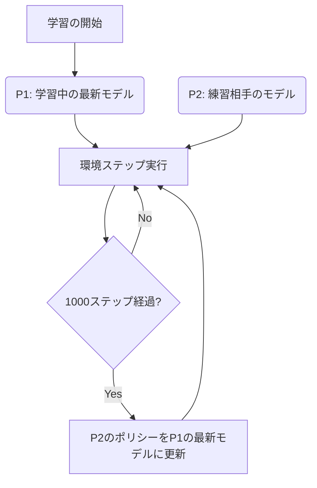

# Klask Reinforcement Learning Agents

このドキュメントでは、MuJoCo 物理エンジン環境における Klask 強化学習エージェントの設計、状態・行動空間、報酬関数、および学習プロセスについて解説します。

---

## 1. 概要 (Overview)

本プロジェクトの Klask エージェントは、**Stable-Baselines3 (SB3)** の **PPO (Proximal Policy Optimization)** アルゴリズムを使用して学習を行います。
また、実用的な強さを獲得するために**セルフプレイ (Self-Play)** を導入しており、学習中のモデル自身を対戦相手（練習相手）として設定し、相互に競争しながらエージェントのポリシーを洗練させます。

---

## 2. エージェントの仕様 (Agent Specifications)

### 2.1. 観測空間 (Observation Space)
エージェントに与えられる観測（状態）は、以下の **4次元** の連続値ベクトルです。すべて `gymnasium.spaces.Box` で正規化され、低次元で効率的な学習を実現しています。

| インデックス | 項目 | 正規化の基準 (分母) | 説明 |
| :---: | :--- | :---: | :--- |
| `0` | ボール (パック) の X 座標 | `0.16` | テーブルの中心を基準としたボールの横方向位置 |
| `1` | ボール (パック) の Y 座標 | `0.21` | テーブルの中心を基準としたボールの縦方向位置 |
| `2` | 自身のストライカーの X 座標 | `0.16` | 自身の初期位置オフセット（`[0, -0.105]`）からの相対X位置 |
| `3` | 自身のストライカーの Y 座標 | `0.21` | 自身の初期位置オフセット（`[0, -0.105]`）からの相対Y位置 |

> [!NOTE]
> 相手プレイヤー (P2) の観測空間 `_get_obs_p2()` では、点対称（X座標とY座標に `-1` を乗算）に変換された上で、共通のエージェントモデルに入力されます。これにより、1つのモデルで先手・後手双方の制御を担当することができます。

### 2.2. 行動空間 (Action Space)
行動空間は **2次元** の連続値ベクトル `[Action_X, Action_Y]` です。範囲は `[-1.0, 1.0]` にクリップされます。

*   **動作の仕組み**: 
    行動値は、それぞれの可動範囲 `range_x` (`[-0.1511, 0.1511]`) および `range_y` (`[-0.0976, 0.0976]`) にマッピングされ、MuJoCo のアクチュエータ（制御入力 `data.ctrl`）に目標位置として直接供給されます。

---

## 3. 報酬設計 (Reward Design)

エージェントが効率的に強くなり、かつ現実的な動き（パックの追従、ゴール狙い、自陣の防御）を学習するために、段階的な報酬・ペナルティ設計（Reward Shaping）を導入しています。

### 3.1. 勝利・得点イベント報酬 (Terminal Rewards)
ゲームが決着した際に与えられる大きな報酬・ペナルティです。

*   **相手ゴール (hole_p2) にパックを入れる**: **`+5000.0`** (ゲーム終了)
*   **相手ストライカーが相手ゴールに落ちる**: **`+2000.0`** (ゲーム終了)
*   **自ゴール (hole_p1) にパックが入る (失点)**: **`-2000.0`** (ゲーム終了)
*   **自ストライカーが自ゴールに落ちる (自滅)**: **`-5000.0`** (ゲーム終了)

### 3.2. 途中ステップ報酬 (Shaping Rewards)
決着がつかない毎ステップで与えられる補助報酬です。これらは「スパースな報酬」による学習の停滞を防ぎます。

1.  **パック追従 (磁力報酬)**
    *   `- (自身のストライカーとパックの距離) * 5.0`
    *   エージェントが常にパックに向かって動くように促します。
2.  **パック接触報酬 (Contact Reward)**
    *   パックに接触した瞬間: **`+200.0`**
    *   さらに、接触時のパックの最大速度に応じたボーナス: **`+ (max_puck_velocity * 50.0)`**
    *   パックを勢いよく弾く動作を強く推奨します。
3.  **パック押し込み報酬 (Puck Push Reward)**
    *   `+ (パックのY座標) * 10.0`
    *   パックを相手陣地側（Y正方向）に押し出すほど、ステップごとに報酬が加算されます。
4.  **タイムペナルティ**
    *   ステップごとに **`-0.1`**
    *   ダラダラとプレイせず、最短で得点することを促します。
5.  **スムーズネス制御**
    *   `- (||今回の行動 - 前回の行動||) * 0.05`
    *   ストライカーの微小な振動や小刻みなブレを抑え、滑らかな移動を学習させます。

---

## 4. セルフプレイ学習 (Self-Play Learning)

対戦相手ポリシーの存在しない静的な環境では、エージェントは決まったパターンしか学習せず、汎用的な強さを獲得できません。そのため、本プロジェクトでは以下のフローでセルフプレイを実施しています。



*   `SelfPlayCallback` を利用して `1000` ステップごとに環境に `set_opponent_policy` を呼び出し、相手プレイヤーの予測モデルを更新します。
*   これにより、自身が強くなればなるほど相手も強くなり、より高度な戦術（相手のシュートをブロックする、隙を突くなど）を自発的に学習していきます。

---

## 5. モデルの保存とエクスポート

### 5.1. Stable-Baselines3 標準形式 (`.zip`)
*   保存先: `models/klask_ppo_model.zip`
*   用途: 学習の再開、SB3ライブラリ経由での推論や enjoy スクリプトでの描画に使用。

### 5.2. ONNX 形式 (`.onnx`)
*   保存先: `models/klask_ppo_model.onnx`
*   用途: 他言語 (C++ や Unity 等) での実行、軽量高速推論。
*   **ONNX出力用ラッパー `OnnxablePolicy`**:
    SB3の標準ポリシーは行動選択の際に確率分布のサンプリング処理を含みますが、実機推論やONNX出力時には不要です。そのため、特徴量抽出器 (`mlp_extractor`) と行動決定層 (`action_net`) のみを抽出した決定論的 (deterministic) な軽量モデルとしてエクスポートしています。

---

## 6. 実行・操作方法 (How to Run)

### 6.1. エージェントの学習
以下のコマンドを実行すると、セルフプレイによる強化学習（100万ステップ）が開始され、終了後に `models/` ディレクトリに SB3 および ONNX 形式でモデルが保存されます。
```bash
python src/klask_rl/train.py
```

### 6.2. 学習済みエージェントの対戦（可視化）
学習させたエージェント同士（セルフプレイ）の3Dシミュレーション描画を起動します。マウスで視点操作が可能です。
```bash
python src/klask_rl/enjoy.py
```
*   **操作方法**:
    *   **左クリック + ドラッグ**: カメラ回転
    *   **右クリック / ホイール**: ズームイン・アウト
    *   **Shift + 左クリック**: 平行移動
    *   **ESC**: 終了

### 6.3. 手動操作でのテスト
キーボードの矢印キーを使って自分でストライカーを動かし、シミュレータの感触を確認できます。
```bash
python src/klask_rl/main.py
```

### 6.4. ONNX推論のテスト
エクスポートした ONNX モデルを読み込み、テスト用の観測データを与えた際の出力値（アクションベクトル）をコンソールに出力します。
```bash
python src/klask_rl/onnx_inference.py
```
