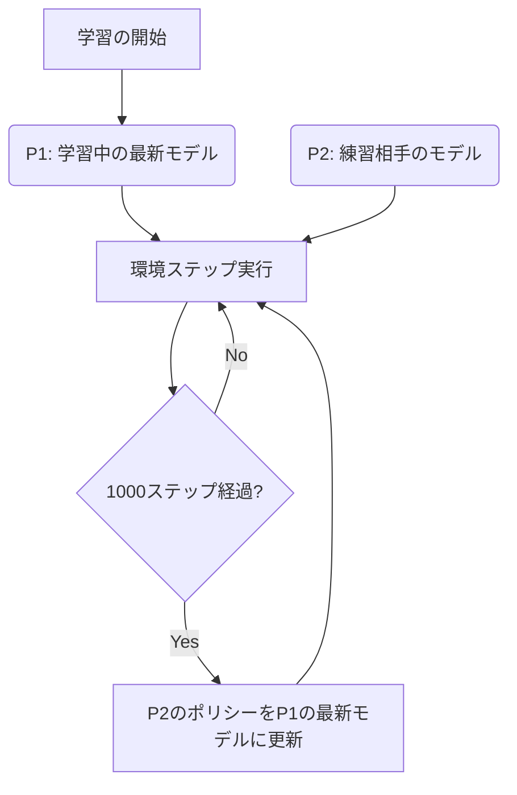

# Klask Reinforcement Learning Agents

このドキュメントでは、MuJoCo 物理エンジン環境における Klask 強化学習エージェントの設計、状態・行動空間、報酬関数、および学習プロセスについて解説します。

---

## 1. 概要 (Overview)

本プロジェクトの Klask エージェントは、**Stable-Baselines3 (SB3)** の **PPO (Proximal Policy Optimization)** アルゴリズムを使用して学習を行います。
また、実用的な強さを獲得するために**セルフプレイ (Self-Play)** を導入しており、学習中のモデル自身を対戦相手（練習相手）として設定し、相互に競争しながらエージェントのポリシーを洗練させます。

---

## 2. エージェントの仕様 (Agent Specifications)

### 2.1. 観測空間 (Observation Space)
エージェントに与えられる観測（状態）は、**`4 * 履歴フレーム数` (デフォルト: 3フレーム = 12次元)** の連続値ベクトルです。すべてテーブル中心 `[0.0, 0.0]` を原点とし、`-1.0` から `+1.0` の範囲に正規化されています。

#### 単一フレームあたりの状態量 (4次元)

| インデックス | 項目 | 正規化の基準 (分母) | 範囲と方向 |
| :---: | :--- | :---: | :--- |
| `0` | ボール (パック) の X 座標 | `0.16` | テーブル中心基準の左右位置。**左端 `-1.0` 〜 右端 `+1.0`** |
| `1` | ボール (パック) の Y 座標 | `0.21` | テーブル中心基準の前後位置。**自陣奥 `-1.0` 〜 相手陣地奥 `+1.0`** |
| `2` | 自身のストライカーの X 座標 | `0.16` | 自身の左右位置。**左端 `-1.0` 〜 右端 `+1.0`** |
| `3` | 自身のストライカーの Y 座標 | `0.21` | 自身の前後位置。**自陣奥 `-1.0` 〜 ハーフライン手前 `0.0`** |

* **履歴スタック**:
  直近3ステップ分 `[t, t-1, t-2]` の状態（計12次元）をキュー（`deque`）で保持して入力します。これにより、エージェントは位置データのみからボールや自分自身の「速度」や「加速度（モータによる制約）」を精度高く推測して行動できます。
* **点対称の保証**:
  相手プレイヤー (P2) の観測空間 `_get_obs_p2()` では、点対称（X・Y座標ともに `-1` を掛け算）に自動反転されて入力されます。これにより、1つのモデルで先手・後手双方の制御を担当します。

### 2.2. 行動空間 (Action Space)
行動空間は **2次元** の連続値ベクトル `[Action_X, Action_Y]` です。範囲は `[-1.0, 1.0]` にクリップされます。

*   **動作の仕組み**: 
    行動値は、それぞれの可動範囲 `range_x` (`[-0.1511, 0.1511]`) および `range_y` (`[-0.0976, 0.0976]`) にマッピングされ、モータ物理制限フィルタ (`MotorFilter`) に供給されます。
    * **`Action_X`**: `-1.0` ➔ 左端、`0.0` ➔ 初期位置（中央）、`1.0` ➔ 右端
    * **`Action_Y`**: `-1.0` ➔ 自陣の最手前、`0.0` ➔ 初期位置（中央やや手前）、`1.0` ➔ ハーフライン際

---

## 3. 報酬設計 (Reward Design)

エージェントが効率的に強くなり、かつ現実的な動き（パックの追従、ゴール狙い、自陣の防御、すくみ行動の回避）を学習するために、段階的な報酬・ペナルティ設計（Reward Shaping）を導入しています。

### 3.1. 勝利・得点イベント報酬 (Terminal Rewards)
ゲームが決着した際に与えられる報酬・ペナルティです（すくみ行動防止のため、旧設定よりマイルドに調整されています）。

*   **相手ゴール (hole_p2) にパックを入れる**: **`+3000.0`** (ゲーム終了)
*   **相手ストライカーが相手ゴールに落ちる**: **`+1000.0`** (ゲーム終了)
*   **自ゴール (hole_p1) にパックが入る (失点)**: **`-1000.0`** (ゲーム終了)
*   **自ストライカーが自ゴールに落ちる (自滅)**: **`-1500.0`** (ゲーム終了)
*(※ XMLの実際のゴールの穴の座標 `[0, +/-0.174]` に正確に同期させて判定しています)*

### 3.2. 途中ステップ報酬 (Shaping Rewards)
決着がつかない毎ステップで与えられる補助報酬です。

1.  **パック追従 (磁力報酬)**
    *   `- (自身のストライカーとパック of 距離) * config.REWARD_BALL_MAGNET`
    *   エージェントが常にパックに向かって動くように促します（デフォルトの係数は 5.0）。
2.  **パック接触報酬 (Contact Reward)**
    *   壁際にボールを押し当てて接触報酬を無限にチャージするハック（すりすり挙動）を防ぐため、**「未接触状態から新しく接触した瞬間（接触の開始）」のみに `+200.0`** を与えます。
    *   さらに、ボールを勢いよく弾く動作（ヒット）を評価するため、接触時にボールの速度が十分にある場合（`0.05m/s`以上）のみ、最大速度比例ボーナス `+ (max_puck_velocity * 50.0)` を加算します。
3.  **パック押し込み報酬 (Puck Push Reward)**
    *   `+ (前ステップからのボールのY軸前進差分 Δy) * 150.0`
    *   自陣（`y < 0`）からであっても、ボールを相手陣地側（Y正方向）に押し進めたら変化量に応じて報酬が支払われます。ボールが壁際で止まって居座っている場合は `Δy = 0` となり報酬は発生しません。
4.  **自陣ボール放置ペナルティ**
    *   ボールが自陣（`y < 0`）にあるとき、自陣の奥深くに放置されている時間に比例して **`p_pos[1] * config.PENALTY_PUCK_IN_OWN_HALF`** のペナルティ（最大約 `-2.0` / ステップ）が加算されます。これにより、自陣放置によるタイムアウト待ち（すくみ）を防止します。
5.  **タイムペナルティ**
    *   ステップごとに **`-0.5`**
    *   何もしないで時間切れ（10秒）を待つと `-150` 点になるため、積極的なアクションを促します。
6.  **スムーズネス制御**
    *   `- (||今回の行動 - 前回の行動||) * 0.05`
    *   ストライカーの微小な振動や小刻みなブレを抑え、滑らかな移動を学習させます。

---

## 4. セルフプレイ学習 (Self-Play Learning)

対戦相手ポリシーの存在しない静的な環境では、エージェントは決まったパターンしか学習せず、汎用的な強さを獲得できません。そのため、本プロジェクトでは以下のフローでセルフプレイを実施しています。



*   `SelfPlayCallback` を利用して `1000` ステップごとに環境に `set_opponent_policy` を呼び出し、相手プレイヤーの予測モデルを更新します。
*   これにより、自身が強くなればなるほど相手も強くなり、より高度な戦術（相手のシュートをブロックする、隙を突くなど）を自発的に学習していきます。
*   **セルフプレイの多様化**: 練習相手の更新時に、80%の確率は最新モデル、20%の確率は過去のチェックポイントからランダムに対戦相手が選ばれます（League-Trainingの簡略版）。これにより、過去の戦術に対する脆弱性（すくみやカタストロフィック・フォゲッティング）を防ぎます。

---

## 5. モデルの保存とエクスポート

### 5.1. Stable-Baselines3 標準形式 (`.zip`)
*   保存先: `models/klask_ppo_model.zip`
*   用途: 学習の再開、SB3ライブラリ経由での推論や enjoy スクリプトでの描画に使用。
*   **中間チェックポイント**: `config.SAVE_CHECKPOINT_STEPS`（デフォルト: 10万）ステップごとに `models/checkpoints/` 内に中間モデルが保存されます。

### 5.2. ONNX 形式 (`.onnx`)
*   保存先: `models/klask_ppo_model.onnx`
*   用途: 他言語 (C++ や Unity 等) での実行、軽量高速推論。
*   **ONNX出力用ラッパー `OnnxablePolicy`**:
    SB3の標準ポリシーは行動選択の際に確率分布のサンプリング処理を含みますが、実機推論やONNX出力時には不要です。そのため、特徴量抽出器 (`mlp_extractor`) と行動決定層 (`action_net`) のみを抽出した決定論的 (deterministic) な軽量モデルとしてエクスポートしています。

---

## 6. 実行・操作方法 (How to Run)

### 6.1. エージェントの学習
以下のコマンドを実行すると、4環境並列（SubprocVecEnv）によるセルフプレイ強化学習（200万ステップ）が開始され、終了後に `models/` ディレクトリに SB3 および ONNX 形式でモデルが保存されます。
```bash
uv run python3 src/klask_rl/train.py
```

### 6.2. 学習済みエージェントの対戦（可視化）
学習させたエージェント同士（セルフプレイ）の3Dシミュレーション描画を起動します。マウスで視点操作が可能です。
```bash
uv run python3 src/klask_rl/enjoy.py
```
*   **操作方法**:
    *   **左クリック + ドラッグ**: カメラ回転
    *   **右クリック / ホイール**: ズームイン・アウト
    *   **Shift + 左クリック**: 平行移動
    *   **ESC**: 終了

### 6.3. 手動操作でのテスト
キーボードの矢印キーを使って自分でストライカーを動かし、シミュレータの感触を確認できます。
```bash
python src/klask_rl/main.py
```

### 6.4. ONNX推論のテスト
エクスポートした ONNX モデルを読み込み、テスト用の観測データを与えた際の出力値（アクションベクトル）をコンソールに出力します。
```bash
python src/klask_rl/onnx_inference.py
```
